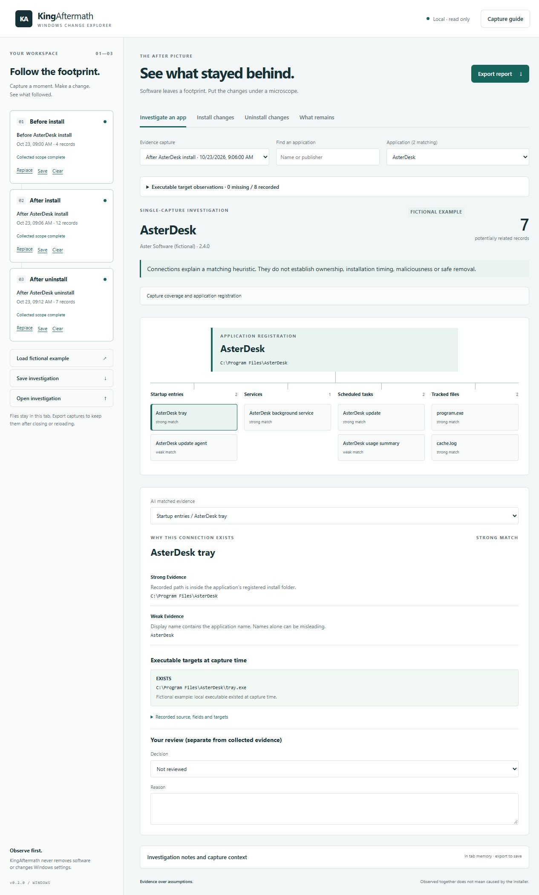

# KingAftermath

**See what stayed behind.** A local Windows change explorer for software installs and uninstalls.

Capture Windows configuration before an install, after the install, and optionally after uninstalling. Explore the differences with source paths and field-level evidence. Export a standalone HTML report that needs no app, account, network connection or JavaScript to read.



## Start locally

Requirements: Node.js 22 or later for the viewer/CLI, and 64-bit Windows PowerShell 5.1 or PowerShell 7 on Windows for collection. No npm dependencies, API keys, database or cloud account are required.

```powershell
cd C:\path\to\KingAftermath
npm start
```

Open **http://127.0.0.1:5190/**. Choose **Load fictional example** to explore without collecting anything from your computer. `PORT` can select another port. The server binds to IPv4 loopback and serves an explicit asset allowlist. It has no upload or collector execution endpoint.

## Capture your own computer

### Windows capture desk

Double-click **Capture.cmd** in the repository folder, or run `powershell -NoProfile -STA -File .\collectors\Start-KingAftermath.ps1`. Create a named investigation, optionally select application folders, then click a capture stage. The window stays responsive and displays the saved path or an error. Profiles and timestamped captures live under `captures/investigations/`. Resume by selecting an investigation folder. Folder scope and target-check preference stay fixed for that profile. The launcher uses Windows PowerShell 5.1 and never requests elevation. Follow your script execution policy.

### Optional collection switches

```powershell
.\collectors\Capture-KingAftermath.ps1 -Label "App investigation" -OutFile .\captures\app.json -CheckTargets -TrackFolder 'C:\Program Files\ExampleApp','C:\Users\YourName\AppData\Local\ExampleApp'
```

Use identical switches/roots for every compared capture. Up to ten local application folders may be selected, including folders that do not exist yet. Drive roots, whole Windows/profile/Program Files/ProgramData roots and network paths are refused. Manifests retain file paths, sizes, SHA-256 hashes and hash status. Reparse points, including root ancestors, are skipped. Bounds: 5,000 files / 20,000 visited entries; 64 MB per hashed file; 512 MB hashed per capture. Limits and skipped/unreadable entries make coverage partial. Size-only records are kept when hashing limits are exceeded.

Target checking handles supported quoted commands and explicit local task paths, expands environment variables and checks local files without executing them. Ambiguous unquoted commands, relative/network paths and reparse paths remain unresolved. Existing, missing, inaccessible and unresolved are distinct. A present interpreter does not prove its script/DLL/arguments exist or are safe. Target metadata is excluded from configuration-diff counts.

### Manual capture

From the repository root in a 64-bit PowerShell terminal:

```powershell
# 1. Before installing your chosen software
.\collectors\Capture-KingAftermath.ps1 -Label "Before install" -OutFile .\captures\before.json

# 2. Install the software normally, then:
.\collectors\Capture-KingAftermath.ps1 -Label "After install" -OutFile .\captures\installed.json

# 3. Uninstall using Windows Settings, let it finish, then:
.\collectors\Capture-KingAftermath.ps1 -Label "After uninstall" -OutFile .\captures\uninstalled.json
```

Follow your organization's script policy if execution is restricted. The collector does not change it. Use the same computer, Windows account, privilege level, collection scope and collector version for all captures. Elevated and standard captures have distinct scope identities and cannot be compared. Elevated access can reveal more configuration, but the tool never requests elevation itself.

Import each JSON file into its corresponding slot. Browser imports stay in tab memory; reloading discards them. The source JSON files remain on disk. Use each slot's **Save** action to download a loaded capture. Keep unrelated installers and updaters quiet during the capture interval. Reboots may trigger legitimate configuration changes; use consistent capture timing and record context separately.

The collector writes only the requested JSON file and its parent directory. Existing output files are refused. `captures/` and `reports/` are ignored by Git.

## Investigate an app without a baseline

Import any one snapshot and choose **Investigate an app**. Select a capture, search registered apps by name/publisher, then inspect the clickable footprint map. Each relationship explains its matching reason: registered install-folder path (strong), exact publisher (medium), or display-name match (weak). These are heuristic match labels, not proof of ownership, timing or security. Portable/Store apps may lack registrations; shared publishers and names can produce false matches.

The map shows up to 12 nodes per category; a full selector retains the rest. Application search displays the first 200 matching registrations and can be narrowed. The **Executable target observations** disclosure covers all entries in the capture, independent of the chosen app, with a status filter; it displays up to 200 matching observations, with full data retained in JSON.

## Three ways to compare

| View | Captures | Interpretation |
|---|---|---|
| Install changes | Before → installed | Configuration differences observed during the interval |
| Uninstall changes | Installed → uninstalled | Configuration differences observed during the uninstall interval |
| What remains | Before → installed → uninstalled | Install-period changes that still differ from baseline; reverted changes, incomplete evidence and other later changes appear separately |

**A residual candidate is not an ownership claim.** Background software or a user may have changed the same settings. A pre-existing entry that remains modified or removed is also a candidate; candidates are not exclusively leftover files. Entries unrelated to the install interval appear as other later changes. Nothing in this tool establishes maliciousness or safe removal.

Search names, identities, paths and recorded commands; filter by source and change type. Select a row for the before/after fields and complete raw evidence. Views paginate at 40 records. Exports include the entire comparison, regardless of the current filters or selected row.

## What is collected

| Source | Declared scope | Stable record identity |
|---|---|---|
| Applications | Named uninstall registry records in current-user and local-machine 32/64-bit views | Hive + registry view + uninstall subkey |
| Startup | Run/RunOnce values in those views; immediate files in current-user/common startup folders | Hive/view/key/value or full file path |
| Services | Selected `Win32_Service` configuration: executable, startup mode, account, description, service type | Service name |
| Scheduled tasks | Accessible `Get-ScheduledTask` records: selected actions, triggers, principal, enabled/hidden settings, author, description | Task path + task name |
| Tracked files (opt-in) | Bounded regular-file manifests in explicitly selected local folders | Full file path |

Startup folder files are hashed, not executed. Shortcuts are not resolved. Service running state, process IDs and task run history are deliberately omitted because routine runtime activity creates misleading differences. Selected task fields are not a full XML configuration export.

Coverage is `complete`, `partial` or `failed` per source. Read failures, oversized records and record caps produce warnings. An empty complete source means no entries were observed in its declared scope. Each source is capped at 20,000 records; input/output snapshots are capped at 25 MB. Registry views can expose aliases of shared entries; they remain separate source-specific observations.

Comparison uses case-insensitive Windows record identities and exact recorded string values. A renamed identity appears as removal/addition. Two observed versions of the same entry can be compared even in a partial source, but one-sided observations become **unconfirmed**. Residual/reverted classification requires complete coverage in all three captures for that source. Other later changes use the baseline-to-final comparison and may also be unconfirmed.

## Notes and investigation packages

Record a title, notes and capture context (for example, reboots or unrelated updates). Evidence records support keep/expected, investigate further, likely unrelated and not-reviewed decisions with reasons. Decisions bind to a capture ID and stable record ID, not a row position.

**Save investigation** exports the three nullable snapshot slots, notes, contexts and decisions into one JSON file. **Open investigation** restores it. Packages are unsigned, capped at approximately 77 MB, and validated for orphan references and text/record limits. Removed evidence has its annotations pruned. Opening a package or loading the demo replaces the tab workspace; export current work first. HTML reports include operator assertions separately from collected evidence. No persistent browser storage is used.

### CLI reports

```powershell
npm run compare -- examples/before.json examples/installed.json --out reports/install.html
npm run compare -- examples/before.json examples/installed.json examples/uninstalled.json --out reports/residuals.html
```

Two input files produce a normal comparison; three produce a residual report. Existing report files and source file paths are protected against overwrite. CLI and viewer use the same parser, comparison engine and report renderer. Example snapshots contain only fictional data.

## Privacy and limits

- Collection is manual and read only. No installer/uninstaller is launched, no cleanup commands are generated, and no system setting is changed.
- Machine GUID and user SID are SHA-256 hashed for matching. Hashing is pseudonymization, not anonymization. Machine name, paths, service accounts, uninstall commands and task arguments may contain private data or even secrets. Review snapshots and reports before sharing.
- Uploaded JSON is never sent to the server. The viewer imports it with browser File APIs. There are no external assets, telemetry or network APIs. The local Node server serves application assets only.
- Snapshot JSON is unsigned. Matching identity strings and valid structure do not prove authenticity. Imported records are treated as text; the HTML report escapes values and disallows scripts.
- This is not a full forensic acquisition, rollback utility, malware scanner or registry backup. Collection is sequential, not atomic; a machine can change during capture.
- No browser extensions, drivers, arbitrary registry changes, whole-computer file tracking, Store package inventory, remote machines, other users' profiles or hidden persistence mechanisms are covered. Windows may omit inaccessible objects without returning an error. Reparse checks are not a sandbox against a hostile concurrent filesystem race.
- No persistent browser storage or encrypted evidence vault is included. Keep exported evidence in an appropriate local location.

## Project layout

```text
app/                         Static interface, shared comparison engine, fictional demo
collectors/                  Read-only Windows PowerShell collector
examples/                    Portable fictional snapshot files
scripts/serve.mjs            Loopback-only asset server
scripts/compare.mjs          CLI HTML reporting
docs/                        Snapshot format and collection references
```

## Build status

Local release **0.2.0**. Run `npm test` for Node regression tests and `npm run test:windows` for collector/target/folder lifecycle checks. Windows checks save private, ignored captures under `test-results/` and use an inert file/junction fixture; no third-party installer or startup/service/task mutation is performed. Never publish those artifacts. See [docs/VERIFICATION.md](docs/VERIFICATION.md), [EXPANSION-GATES.md](EXPANSION-GATES.md) and [ROADMAP.md](ROADMAP.md) for actual evidence and remaining limits.

MIT licensed. Created by BradKingMe.
